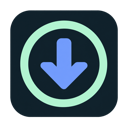
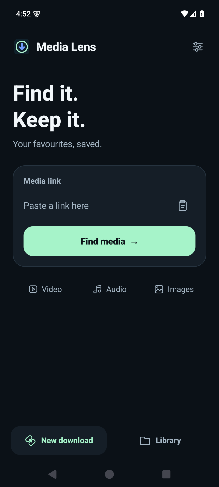

<p align="center"></p>
<h1 align="center">Media Lens</h1>
<p align="center"><strong>Save videos. Grab images. Keep the good stuff.</strong><br>Free, open-source media downloads for Brave, Chrome and Android.</p>
<p align="center"><a href="https://github.com/GraemeVIP/MediaLens/releases">Download releases</a> · <a href="#install-the-browser-extension">Browser setup</a> · <a href="android/README.md">Android</a> · <a href="https://github.com/GraemeVIP/MediaLens/issues">Help & ideas</a></p>

<p align="center"></p>

## Your browser, with a download button

Download from **YouTube, X / Twitter, Vimeo and adult platforms including Pornhub (PH), xHamster, XVideos, XNXX and RedGifs** using the power of yt-dlp. Media Lens brings videos, page images and selective batch downloads into one toolbar popup. Processing happens on your device, with no Media Lens account or hosted conversion service.

- **Pick your videos.** On a channel or listing page, tick the clips you want and queue up to 100. Three video downloads can run together, even after you close the popup.
- **Choose your quality.** Download video with audio at an offered resolution, choose a maximum resolution for a batch, or save audio only. FFmpeg joins separate video and audio tracks.
- **Save images too.** Select individual images or a whole batch. Finds full-size links, responsive and lazy-loaded images, posters and background images. Filter small images out of the grid.
- **Follow the progress.** Reopen the popup to check downloads, cancel or retry, and open the destination folder. Clearing finished history keeps your saved files.
- **Take it to Android.** A native app accepts pasted links and links shared from your browser. The download engine runs on your phone. [Android setup and beta status →](android/README.md)

## Sites & sources

| Platforms | Download support |
| --- | --- |
| **Pornhub (PH), xHamster, XVideos, XNXX, RedGifs** | Dedicated yt-dlp extractors for adult platforms |
| **YouTube, X / Twitter, Vimeo** | Dedicated yt-dlp extractors for social and video platforms |
| **Many more sites** | [yt-dlp's supported sites](https://github.com/yt-dlp/yt-dlp/blob/master/supportedsites.md) and generic extraction |
| Direct MP4 / WebM, HLS and DASH | Page scanning and the local engine |
| Page images | Browser scanner: full-size links, srcset, lazy loading, CSS backgrounds and posters |
| Direct image links | Browser extension and Android app |

These site names describe extractor support, not a guarantee for every page. Login, age gates, region, anti-bot checks and site changes can affect availability. DRM-protected streams are unsupported. Keep the download engine updated. [What we have tested →](docs/TESTING.md)

## Install the browser extension

**macOS · Brave or Chrome · technical GitHub installation**

The browser popup needs the local companion for downloads. Python 3, Node.js and FFmpeg run on your Mac; no external SSD is required. Homebrew users can install them with:

```sh
brew install python node ffmpeg
```

1. [Download a release](https://github.com/GraemeVIP/MediaLens/releases) and unzip it into a permanent folder, or clone this repository.
2. Open `brave://extensions` or `chrome://extensions`, enable **Developer mode**, choose **Load unpacked**, and select the folder containing `manifest.json`.
3. Double-click **Install Companion.command** in that folder. If Finder blocks the script, run `zsh "Install Companion.command"` in Terminal from the folder. It creates a private Python environment, installs yt-dlp and registers the extension with Brave and Chrome.
4. Pin Media Lens to the toolbar. Open a page and click its icon. Use **Videos**, **Images** or **Downloads**.

Requires Chromium 116 or newer. Keep the extension folder in place. Downloads go to `~/Downloads/Media Lens`; image batches have separate folders. Windows and Linux companion installers are not included yet.

### Signed-in sites

Settings can opt into reading cookies from Brave or Chrome locally when a site needs your signed-in session. This is off by default. Media Lens has no server that receives your cookies, browsing history or downloads. The download engine contacts source sites and update/dependency services directly. See [privacy details](docs/PRIVACY.md).

### Updates

Pull the latest source or replace the release files, then reload the extension on the extensions page. Run **Install Companion.command** after companion code changes. Use **Update Video Engine.command** or the popup's engine update control for yt-dlp updates.

## Android

See [the Android app](android/README.md) for installation, building and device compatibility. It includes its own engine, accepts **Share → Media Lens**, and saves finished files in **Downloads / Media Lens**. Browser page-image scanning and channel checkbox selection are desktop extension features.

## Build & contribute

No npm packages are needed for the extension:

```sh
npm run check
npm test
```

[Contributing](CONTRIBUTING.md) · [Roadmap](docs/ROADMAP.md) · [Launch announcement](docs/LAUNCH.md)

Media Lens source is licensed **GPL-3.0-or-later**. Thanks to [yt-dlp](https://github.com/yt-dlp/yt-dlp), [FFmpeg](https://ffmpeg.org/) and [youtubedl-android](https://github.com/yausername/youtubedl-android). Dependencies retain their own licences; see [third-party notices](THIRD_PARTY_NOTICES.md). The project icon was created for Media Lens with OpenAI image generation.
